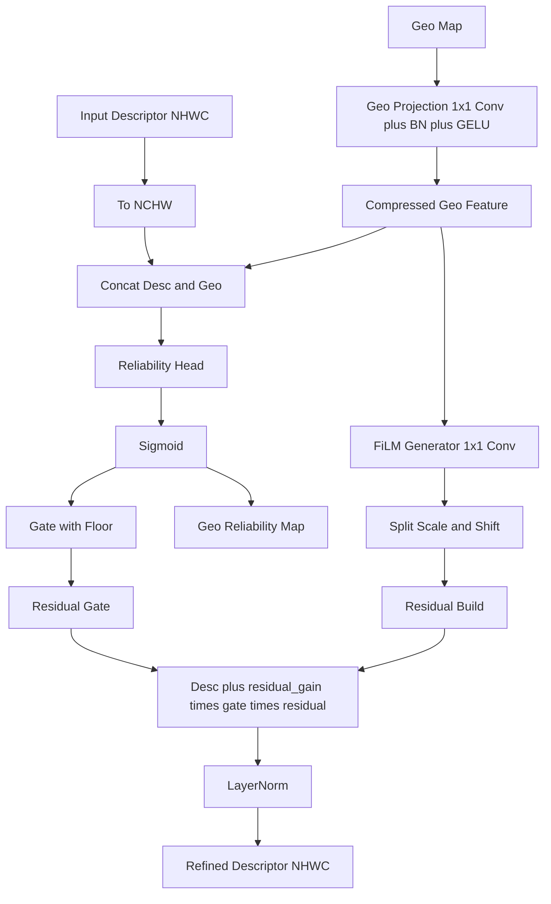

# GeoFeat: Multi-Order Geometric Feature Fusion for Robust Local Descriptor Learning

> **GeoFeat** 是一个创新的局部特征描述子学习框架，通过融合多阶几何信息（深度、法向量、曲率）并结合 AFTAttention 机制，显著提升了图像匹配在复杂几何场景下的鲁棒性。

配置唯一入口是 [src/config/config.py](src/config/config.py)。训练脚本不再读取或合并 YAML；模型与损失的冻结契约位于 [src/model/GeoFeatModel.py](src/model/GeoFeatModel.py)，仅数据集、训练、增强及显式消融开关在 `config.py` 中调整。

## 当前主线

- 训练入口只保留 [train.py](train.py)。
- 推理可视化入口保留 [visualize_inference.py](visualize_inference.py)，现在通过 `--run-dir` 或 `--config-path` + `--weights-path` 显式加载当前权重快照。
- 评测入口保留 [evaluation/HPatch_evaluation.py](evaluation/HPatch_evaluation.py)、[evaluation/MegaDepth1500_evaluation.py](evaluation/MegaDepth1500_evaluation.py) 和 [evaluation/ScanNet1500_evaluation.py](evaluation/ScanNet1500_evaluation.py)，它们会从 checkpoint 所在目录自动读取 `config_snapshot.json`。
- 历史训练脚本和根目录实验脚本已迁入 [legacy/archive/train/README.md](legacy/archive/train/README.md) 与 [legacy/archive/tools/README.md](legacy/archive/tools/README.md)。
- 当前主线细化模块固定为 GCDR；Local/GCLA 仅作为历史实现保留在归档语义中，不再属于默认训练路径。

## 📅 项目动态 (Project Status)

## 🎯 核心功能 (Core Features)

### 1. 多阶几何特征融合 (Multi-Order Geometric Fusion)

GeoFeat 首次系统性地引入了 0-2 阶几何信息，弥补了传统纹理描述子在几何模糊区域的缺陷：

| 几何阶数 | 特征类型 | 物理意义 | 关键作用 |
|---------|---------|---------|---------|
| **0阶** | 深度 (Depth) | 3D 位置 | 提供绝对尺度感知 |
| **1阶** | 法向量 (Normal) | 表面朝向 | 捕捉平面与斜面变化 |
| **2阶** | 曲率 (Curvature) | 表面弯曲 | 识别角点、边缘与复杂曲面 (k₁, k₂, K, H) |

### 2. 几何感知注意力与增强 (Geometric Attention & Enhancement)

- **AFTAttention (Attention-Free Transformer)**: 
  采用高效的 AFT 机制替代传统 Self-Attention，在保持全局感受野的同时大幅降低计算复杂度，实现几何特征的全局交互。

- **GCDR (Geo-Conditional Descriptor Refinement)**:
  当前主线在全局注意力之前利用几何特征对描述子做条件调制，让后续 AFTAttention 直接建立在 geometry-aware descriptor 上。对应实现位于 [src/model/GeoFeatModel.py](src/model/GeoFeatModel.py) 的 `FeatureBooster.pre_attn_refiner`。
  当前固定主线为：几何压缩 -> 可靠性预测 -> FiLM 调制 -> 残差注入 -> LayerNorm，不再暴露旧的 Local/GCLA 分支选择。

#### 2.1 当前 GeoFeat 实际框架图 (与代码一致)

下面这张图是按当前实现整理的真实数据流（尤其修正了 GCDR 与 Linear Attention 的先后关系）：

```mermaid
flowchart LR
  I[Input Image] --> B[Backbone: Standard or RepVGG]

  B --> KF[Feature Fusion x3 x4 x5]
  KF --> KH[Keypoint Head]
  KF --> DH[Descriptor Head]
  KF --> GH[Geo Head]

  GH --> GP[Geo Preprocess]
  DH --> DE[Descriptor Encoder]
  GP --> GE[Geo Branch Encoders]
  DE --> ADD1((Add))
  GE --> ADD1

  KH --> FB[FeatureBooster]
  ADD1 --> FB

  FB --> GCDR[GCDR Pre-Attention Refinement]
  GCDR --> ATTN[AttentionalNN with AFT Blocks]
  ATTN --> NORM[L2 Normalize]
  NORM --> DESC[Descriptor 64D]

  NORM --> REP[Repeatability Head]
  REP --> PROJ[1x1 Projection to Keypoint Dim]
  KH --> MIX
  PROJ --> MIX
  MIX[Keypoint Logits Fusion alpha] --> RK[Refined Keypoint Logits]
```

说明：
- 当前主干实现中，Geo Head 直接来自 Backbone 融合特征，不依赖独立的 DepthAnything 前向分支。
- 当前默认 `REFINER_TYPE=GCDR`，并且 GCDR 在注意力之前执行（pre-attention）。
- 输出端同时产生描述子与重复性图，重复性图会按 `REPEATABILITY_ALPHA` 融合回关键点 logits。

#### 2.2 GCDR 模块展开图 (重点)

GCDR 的核心计算可写为：

$$
r = \sigma(\text{RelHead}([d, g]))
$$

$$
\hat{g} = \text{GeoProj}(g),\quad [s, b] = \text{FiLM}(\hat{g})
$$

$$
\gamma = g_{\min} + (1-g_{\min})\cdot r
$$

$$
\Delta d = (d \odot \tanh(s) + b) \odot \gamma
$$

$$
d' = \text{LayerNorm}(d + \lambda\cdot\Gamma\cdot\Delta d)
$$

其中：
- $r$ 是像素级几何可靠性。
- $\gamma$ 是由可靠性下限约束后的门控权重。
- $\lambda$ 对应 `residual_gain`。

#### 2.3 配置到模块的对应关系

在 [src/config/config.py](src/config/config.py) 中：
- `MODEL.REFINER_TYPE` 当前主线固定使用 `GCDR`。
- `MODEL.GCDR.GEO_COMPRESS` 控制几何压缩通道。
- `MODEL.GCDR.RELIABILITY_HIDDEN` 控制可靠性预测头的隐藏通道。
- `MODEL.GCDR.GATE_FLOOR`、`RESIDUAL_GAIN`、`RESIDUAL_GATE_FLOOR` 控制残差注入强度与下限。
- `LOSS.RELIABILITY_LOSS_WEIGHT`、`RELIABILITY_CONSISTENCY_WEIGHT`、`RELIABILITY_TARGET_SCALE` 控制可靠性监督。

### 3. 高分辨率几何解耦 (High-Res Geometry Unfolding)

传统的下采样过程会丢失高频几何细节。GeoFeat 采用了 **Geometry Unfolding** 技术：
- 将高分辨率的几何图（如 8x8 块）展开并堆叠到通道维度。
- 使 1/8 分辨率的特征图能够感知原始分辨率的几何细节，从而在低分辨率下也能保持高精度的几何感知能力。

### 4. 混合骨干网络架构 (Hybrid Backbone Architecture)

- **多尺度融合**: 融合 $x3, x4, x5$ 层特征，兼顾局部纹理细节与高层语义信息。
- **灵活性**: 支持 Standard CNN 与 RepVGG 骨干网络，可根据推理速度需求灵活切换。

