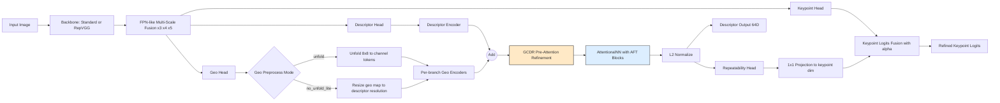
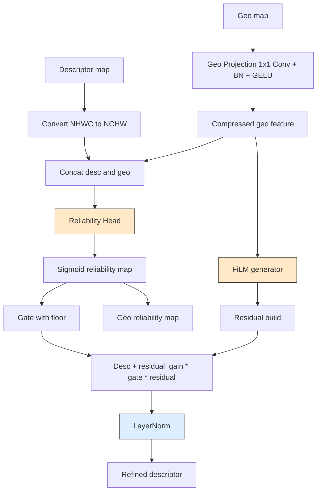

# GeoFeat Mainline Framework Diagram

This diagram matches the converged mainline in [src/model/GeoFeatModel.py](src/model/GeoFeatModel.py): `train.py` is the only supported training entrypoint, and `GCDR` is the fixed descriptor refiner path.

## GCDR Internal Expansion

## Mainline Config Mapping

- `MODEL.REFINER_TYPE`: current mainline uses `GCDR`.
- `MODEL.GCDR.GEO_COMPRESS`: geometry compression width.
- `MODEL.GCDR.RELIABILITY_HIDDEN`: hidden width of the reliability head.
- `MODEL.GCDR.GATE_FLOOR`, `RESIDUAL_GAIN`, `RESIDUAL_GATE_FLOOR`: residual injection strength and lower bounds.
- `LOSS.RELIABILITY_LOSS_WEIGHT`, `RELIABILITY_CONSISTENCY_WEIGHT`, `RELIABILITY_TARGET_SCALE`: reliability supervision terms used by the training loss.
